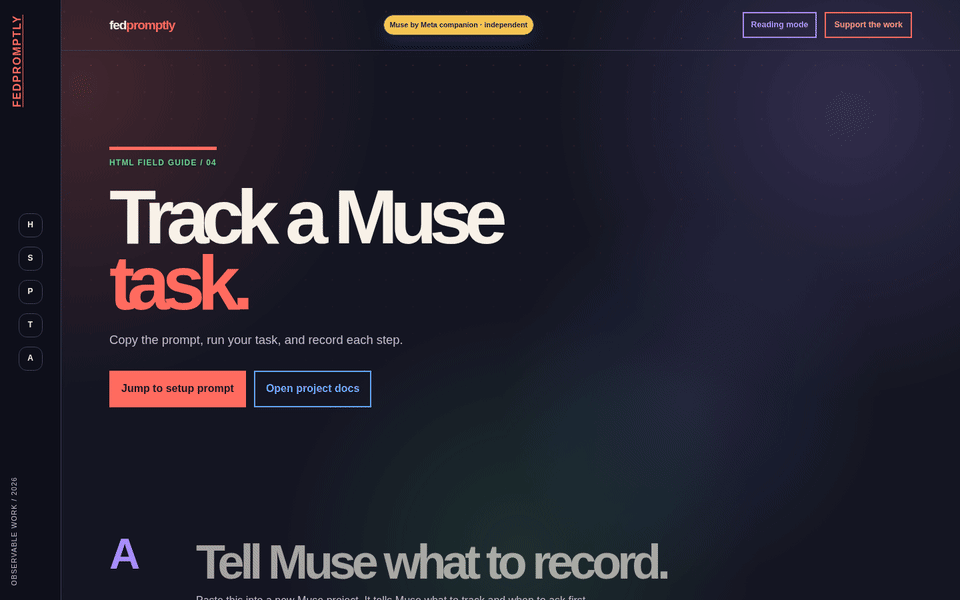
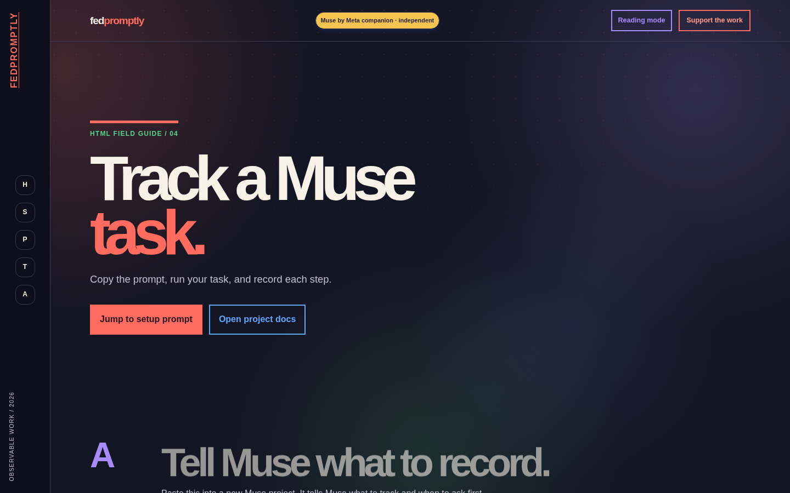
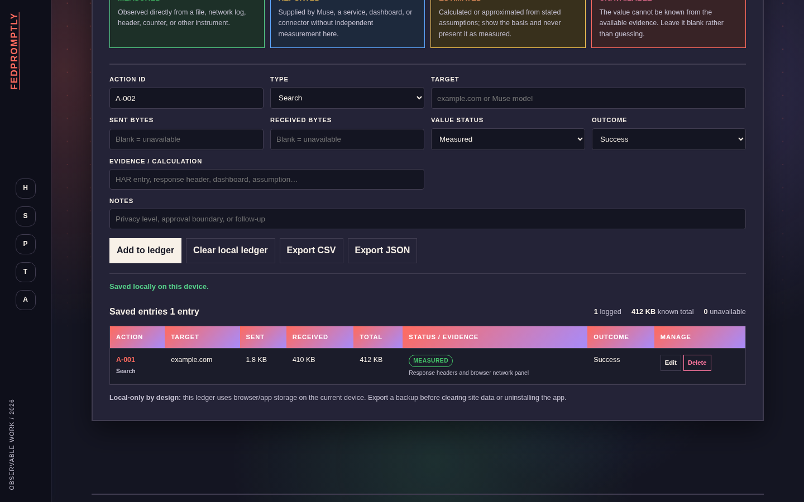
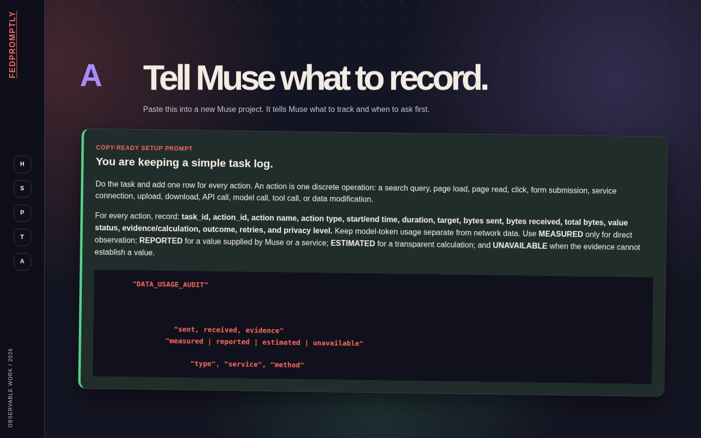
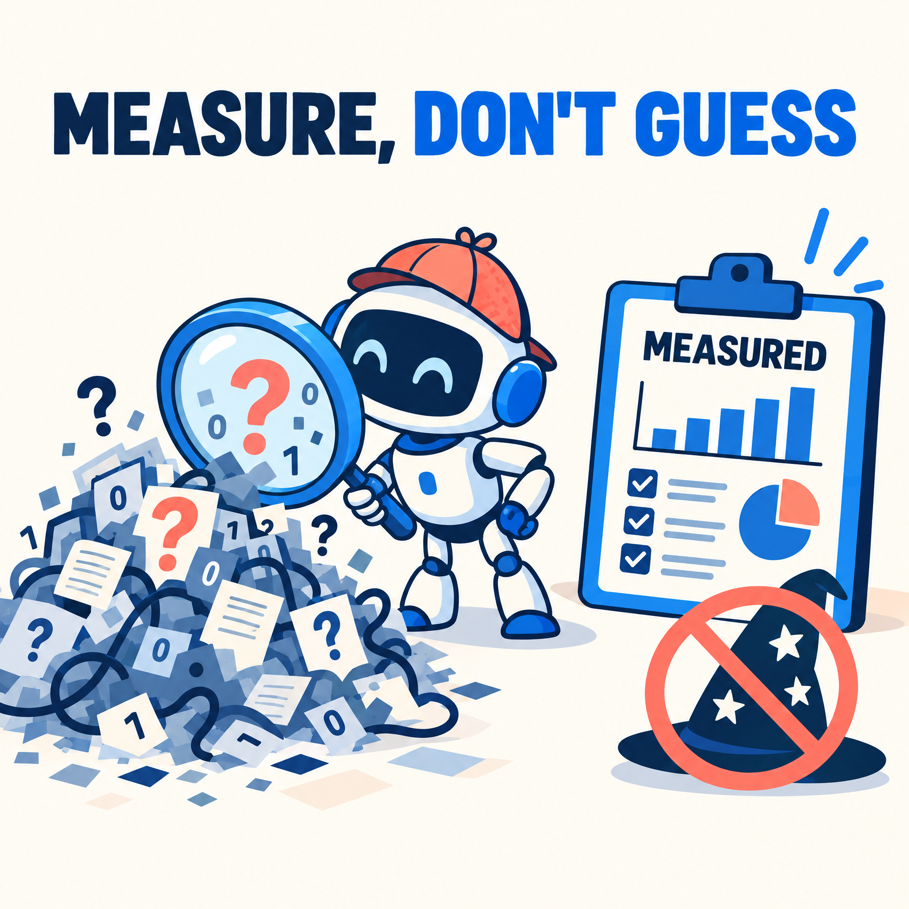

# FedPromptly × Muse by Meta

> An offline-first field guide and local ledger for understanding multi-step Muse workflows without pretending to have telemetry you cannot see.

## Why this exists

AI agents can search, read, click, upload, download, call tools, and modify data faster than a person can reconstruct what happened afterward. That makes it easy to confuse model tokens with network traffic, estimates with measurements, or a successful-looking result with a properly bounded action.

FedPromptly Muse Audit exists to make those boundaries visible. It gives you copy-ready prompts, practical lessons, and a device-local ledger for recording evidence one action at a time. It is independent of Meta, does not connect to a Meta account, and does not claim access to private Muse telemetry.

## See it work

[](site/usage-audit.html)

The demo shows the real PWA flow: open the audit mode, add an action to the local ledger, review the saved entry, and export the record. Nothing is sent to a server.

**[Try the live demo →](https://git-fed.github.io/MuseAi-Skills-Guide/)**

## Screenshots

| Audit mode | Local ledger | Copy-ready workflow |
| --- | --- | --- |
|  |  |  |

## Simple promotion images

Use these light-hearted images in release posts, social updates, or project discussions:




## What is included

- **Web/PWA:** the self-contained static app in [`site/`](site/) with a device-local `localStorage` ledger.
- **Skills Guide:** five ready-to-install examples in [`SKILLS.md`](SKILLS.md), plus the source files in [`skills/`](skills/).
- **Lessons and modules:** a progressive curriculum from orientation through capstone projects in [`lessons/`](lessons/) and [`modules/`](modules/).
- **Desktop and Android shells:** optional wrappers around the same canonical site under [`desktop/`](desktop/) and [`android/`](android/).
- **Privacy boundaries:** guidance that keeps measured, reported, estimated, and unavailable values separate.

## Run it locally

```bash
git clone https://github.com/Git-FED/MuseAi-Skills-Guide.git
cd MuseAi-Skills-Guide/site
python3 -m http.server 8080
```

Open <http://localhost:8080/>. The main audit experience is at <http://localhost:8080/usage-audit.html>.

The PWA works as static HTML, including from `file://`. Ledger entries remain in the current browser or WebView until you explicitly export or clear them.

## Install a skill today

Start with the [Skills Guide](SKILLS.md). Each example is a standalone Markdown skill that can be copied into a skills directory or adapted into a project instruction:

```bash
mkdir -p .skills
cp skills/audit-ledger/SKILL.md .skills/
```

The examples cover audit-ledger tracking, privacy-boundary review, lesson planning, prompt review, and project scoping. They are intentionally small enough to inspect before installing.

## Roadmap

See [`ROADMAP.md`](ROADMAP.md) for the current plan and the public roadmap issue on GitHub.

## Trust and security

Read [`SECURITY.md`](SECURITY.md) before installing an APK or desktop binary. The project is local-first: no account, backend, API key, analytics SDK, or automatic third-party loader is required. Explicit external links open only after user activation in the default system handler.

## License

This project is available under the [MIT License](LICENSE).
